Что же ж. Приступим потихоньку.

## Part 1. Настройка gitlab-runner

== Задание ==

Подними виртуальную машину Ubuntu Server 22.04 LTS.\
Скачай и установи на виртуальную машину gitlab-runner.\
Запусти gitlab-runner и зарегистрируй его для использования в текущем проекте (DO6_CICD).\
Для регистрации понадобятся URL и токен, которые можно получить на страничке задания на платформе.

Запускаем следующие команды:
```
apt update && apt upgrade -y
apt install gitlab-runner -y
gitlab-runner register
```

Вводим URL нашего гитлаба, токен. Сильно рекомендую использовать теги. Я ввел stilwool,do6,shell.

Можно поглядеть, что получилось
```
root@do6-runner:~# cat /etc/gitlab-runner/config.toml
concurrent = 1
check_interval = 0
connection_max_age = "15m0s"
shutdown_timeout = 0

[session_server]
  session_timeout = 1800

[[runners]]
  name = "do6-runner"
  url = "https://repos.21-school.ru"
  id = 15454
  token = "4b4Yqrqj-XHYYuwP3m9E"
  token_obtained_at = 2025-02-11T12:33:14Z
  token_expires_at = 0001-01-01T00:00:00Z
  executor = "shell"
  [runners.custom_build_dir]
  [runners.cache]
    MaxUploadedArchiveSize = 0
    [runners.cache.s3]
    [runners.cache.gcs]
    [runners.cache.azure]
```

### АТЕНСЬЁН!!! 

Далее будет 2 раза про одно и тоже, потому как одни и те же задачи можно выполнить по разному.\
Сначала я выполню так, как выполняет енто большинство (как я понял, почитав группу в телеге),\
потом сделаю так, как считаю более правильным.

Также должен отметить, что некоторые этапы будут более внимательно освещены отдельно.

Итак..

## Способ 1

## Part 2. Сборка

== Задание ==\
Напиши этап для CI по сборке приложений из проекта C2_SimpleBashUtils.\
В файле gitlab-ci.yml добавь этап запуска сборки через мейк файл из проекта C2.\
Файлы, полученные после сборки (артефакты), сохрани в произвольную директорию со сроком хранения 30 дней.

```
stages:
  - build

build-job:
  stage: build
  tags:
    - stilwool
    - do6
    - shell
  script:
    - make -C ./src/cat/
    - make -C ./src/grep/
  artifacts:
    paths:
      - src/cat/s21_cat
      - src/grep/s21_grep
    expire_in: 30 days
```

Вот, в сущности и все, что нам нужно. Можно еще перенести собранные файлы поближе, тогда артефакты собирать будет проще.

```
stages:
  - build

build-job:
  stage: build
  tags:
    - stilwool
    - do6
    - shell
  script:
    - make -C ./src/cat/
    - make -C ./src/grep/
    - mv src/cat/s21_cat ./
    - mv src/grep/s21_grep ./
  artifacts:
    paths:
      - s21_cat
      - s21_grep
    expire_in: 30 days
```

Выполнены все условия, как и просят. Теперь запускаем и... о чем-то вспоминаем.

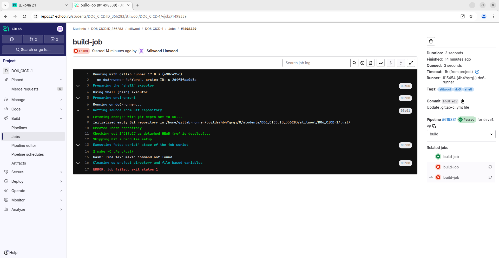\
*Part2. Вот же ж блин*

Поскольку мы только что обновили репозиторий, то просто шлепаем 
```
apt install make -y
```

Перезапускаем задачу и опять о чем-то вспоминаем.

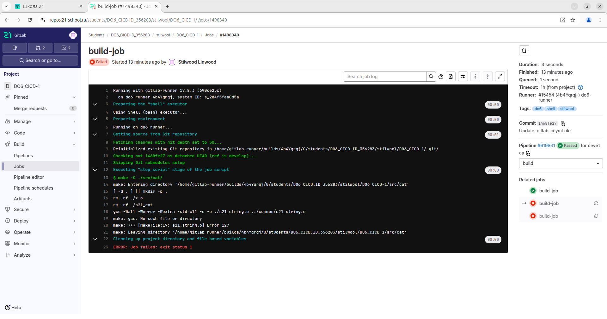\
*Part2. Вот же ж дважды блин*

Ваааааще не страшно.
```
apt install gcc -y
```

И ура! Оно сработало.

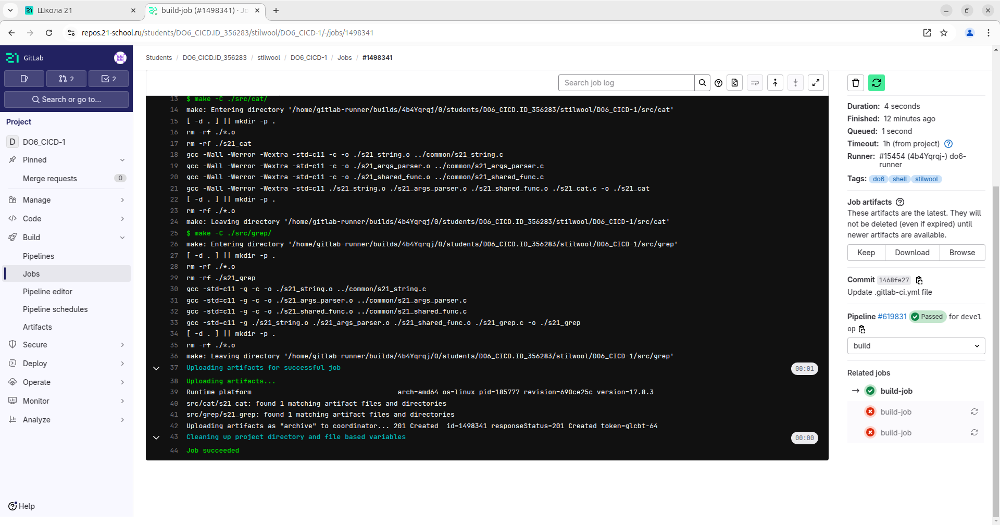\
*Part2. Больше не пищит*

Хочу только обратить внимание на одну маленькую деталь:

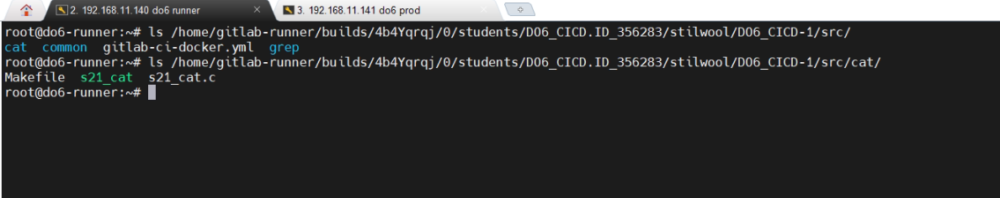\
*Part2. У нас есть традиция присесть на дорожку, но нет традиции убрать за собой*

По идее, в таком случае, мы должны делать отдельную стадию для очистки. Что-то вроде:
```
clean:
  stage: cleanup
  script:
  - echo "Time to clean up"
  after_script:
  - set "BUILD_DIR=%CI_PROJECT_DIR%"
  - set "BUILD_DIR=%BUILD_DIR:/=\%"
  - echo "Cleaning %BUILD_DIR%"
  - rmdir /S /Q %BUILD_DIR%
  - exit /b 0
```
См. вот енту статью https://gitlab.com/gitlab-org/gitlab-runner/-/issues/3856

## Part 3. Тест кодстайла

== Задание ==\
Напиши этап для CI, который запускает скрипт кодстайла (clang-format).\
Если кодстайл не прошел, то «зафейли» пайплайн.\
В пайплайне отобрази вывод утилиты clang-format.

Тут не сложно. Просто добавляем еще один этап и еще одну задачу:
```
stages:
  - build
  - tests
...
clang-test-job:
  stage: tests
  needs:
    - job: build-job
      artifacts: false
  tags:
    - stilwool
    - do6
    - shell
  script:
    - apt update && apt install clang-format -y
    - cp ./materials/linters/.clang-format ./src/cat/.clang-format
    - cp ./materials/linters/.clang-format ./src/grep/.clang-format
    - clang-format -Werror -n ./src/cat/*.c
    - clang-format -Werror -n ./src/grep/*.c
```

Как видите, мы поумнели, на случай, если на сервере нет кланга, ставим кланг.\
Копируем линтер, выставляем флаг "-Werror", который в случае ошибки выдаст "exit 1" и проверяем. Чего уж проще. Ведь так?

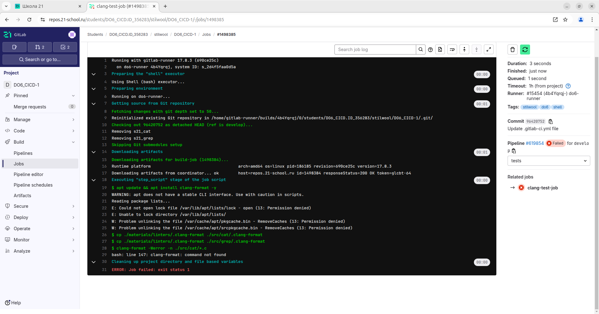\
*Part3. Никогда не надоест*

А все потому, что у гитлаб-раннера есть свой пользователь, и его права ограничены.

Ок. Ставим кланг формат и перезапускаем задачу.

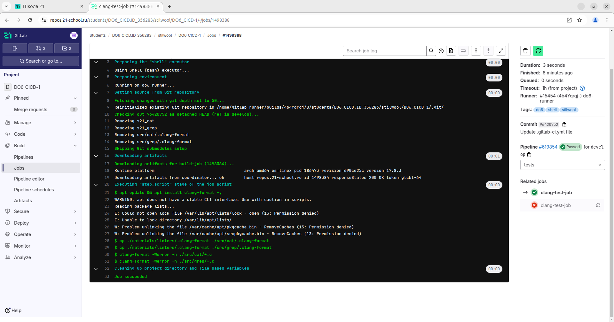\
*Part3. Проверили*

## Part 4. Интеграционные тесты

== Задание ==\
Напиши этап для CI, который запустит интеграционные тесты.\
Для проекта C2_SimpleBashUtils можешь взять свои уже написанные интеграционные тесты.\
Для проекта из папки code-samples напиши интеграционные тесты самостоятельно. Тесты могут быть написаны на любом языке (c, bash, python и т.д.) и должны вызывать собранное приложение для проверки его работоспособности на разных случаях.\
Запусти этот этап автоматически только при условии, если сборка и тест кодстайла прошли успешно.\
Если тесты не прошли, то «зафейли» пайплайн.\
В пайплайне отобрази вывод, что интеграционные тесты успешно прошли / провалились.

АТЕНСЬЁН!!! Тесты будут одной из тем, которой будет посвящена отдельная глава.\
Пока что ограничимся тем, что мы делали при написании самих s21_cat и s21_grep, только возьмем тесты не на BASH, а на питоне.

Создадим папку cicd в materials. На данном этапе тест выглядит так:
```
import os
import subprocess
import sys
from colors import Color

test_presets = "test_presets.txt"

def run(my, og, pwd):
    os.chdir(pwd)
    if not os.path.isfile(test_presets):
        print("File with arg presets 'test_presets.txt' not found")
        sys.exit(1)
        
    if not os.path.isfile(my):
        print(f"Пожалуйста, положи свой {Color.BOLD}{my[2:]}{Color.NC} в {Color.BOLD}{pwd}{Color.NC}")
        sys.exit(1)

    with open(test_presets) as tests:
        for test in tests:
            if not test.rstrip():
                print('----')
                continue

            args = test.rstrip().split(' ')
            with open("out1", "w") as out1:
                subprocess.run([my] + args, stdout=out1)
            with open("out2", "w") as out2:
                subprocess.run([og] + args, stdout=out2)

            diff_res = subprocess.run(["diff", "-q", "out1", "out2"], capture_output=True, text=True)
            if not diff_res.stdout:
                print(f"{Color.GREEN}PASS:{Color.NC} ", end="")
                print(" ".join(args))
            else:
                print(f"{Color.RED}FAIL:{Color.NC} ", end="")
                print(" ".join(args))
                print("Expected: ")
                print(Color.BLUE, end='')
                with open("out2", "r") as f:
                    print(f.read(), end='')
                print(Color.NC, end='')
                print("Got: ")
                print(Color.YELLOW, end='')
                with open("out1", "r") as f:
                    print(f.read(), end='')
                print(Color.NC, end='')
                subprocess.run(["rm", "-rf", "out1"])
                subprocess.run(["rm", "-rf", "out2"])
                sys.exit(1)

            subprocess.run(["rm", "-rf", "out1"])
            subprocess.run(["rm", "-rf", "out2"])
```

Суть его проста, каждая строчка файла пресетов - ключи и агрументы к команде. Выполняем нами написанную и оригинал.\
Если вывод не совпадает, выходим с ошибкой. Получится примерно так (я поправил свой cat, для наглядности):

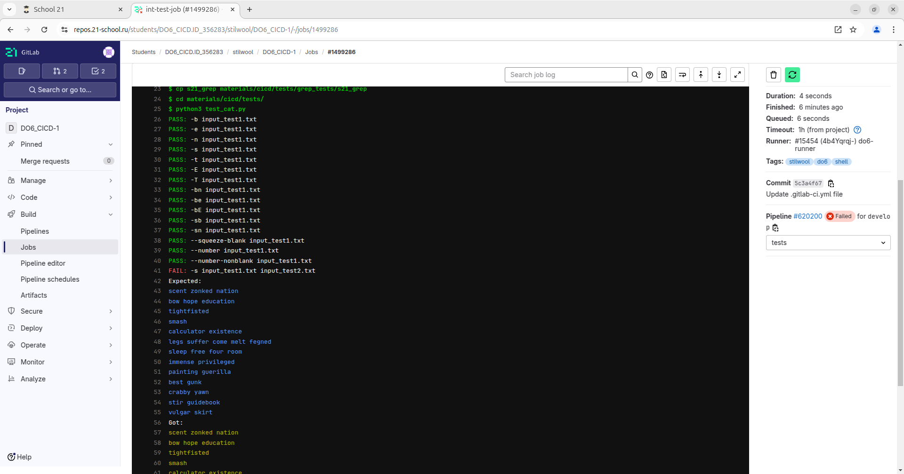\
*Part4. Одна ошибка - и ты ошибся*

Сам же пайплайн обзавелся еще одной задачей (естесственно, не будь на сервере питона, то пошло бы не так гладко):
```
int-test-job:
  stage: tests
  needs:
    - job: build-job
      artifacts: true
    - job: clang-test-job
      artifacts: false
  tags:
    - stilwool
    - do6
    - shell
  script:
    - cp s21_cat materials/cicd/tests/cat_tests/s21_cat
    - cp s21_grep materials/cicd/tests/grep_tests/s21_grep
    - cd materials/cicd/tests/
    - python3 test_cat.py
    - python3 test_grep.py
```

Если же проблем нет, то тесты заканчиваются успешно: 

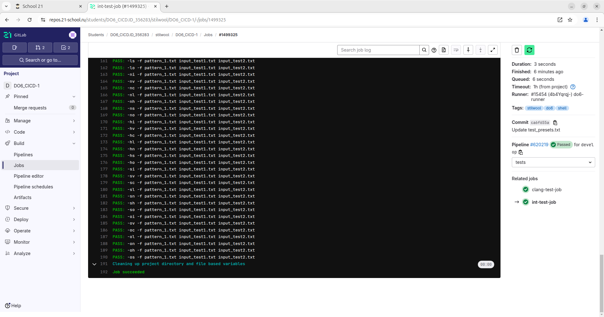\
*Part4. Усё прошло успешно*

Дополнительно проверим, что будет, если клангу что-то не понравится:

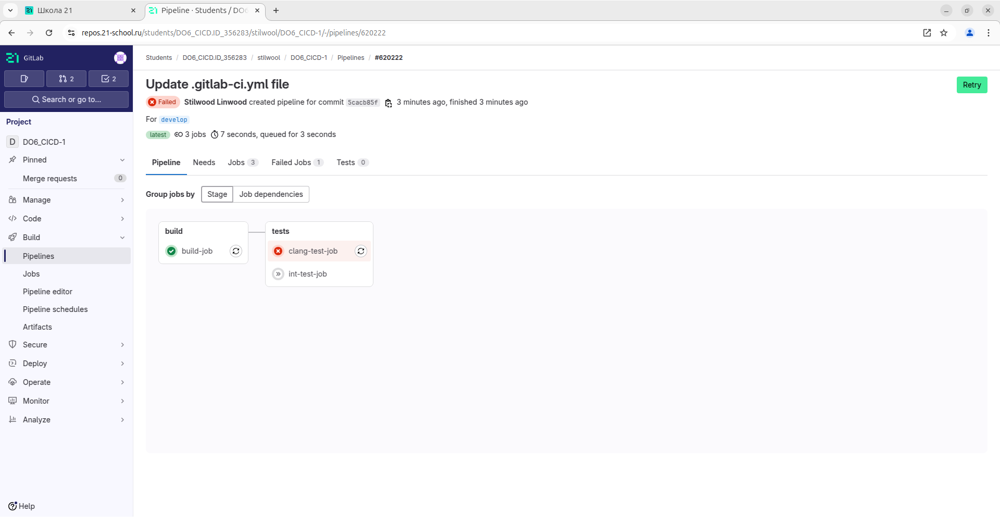\
*Part4. Условие непродолжения пайплайна для фейле выполнено*

## Part 5. Этап деплоя

== Задание ==\
Подними вторую виртуальную машину Ubuntu Server 22.04 LTS.\
Напиши этап для CD, который «разворачивает» проект на другой виртуальной машине.\
Запусти этот этап вручную при условии, что все предыдущие этапы прошли успешно.\
Напиши bash-скрипт, который при помощи ssh и scp копирует файлы, полученные после сборки (артефакты), в директорию /usr/local/bin второй виртуальной машины.\
Тут тебе могут помочь знания, полученные в проекте DO2_LinuxNetwork.\
Будь готов объяснить по скрипту, как происходит перенос.\
В файле gitlab-ci.yml добавь этап запуска написанного скрипта.\
В случае ошибки «зафейли» пайплайн.\
В результате ты должен получить готовое к работе приложения из проекта C2_SimpleBashUtils (cat и grep) или приложение из папки code-samples (DO) на второй виртуальной машине (в зависимости от того, что ты выполнял).

Надо признать, идем довольно бодренько. В том ли направлении? А, не важно.

Первым делом настраиваем связь между нашим раннером и продом.

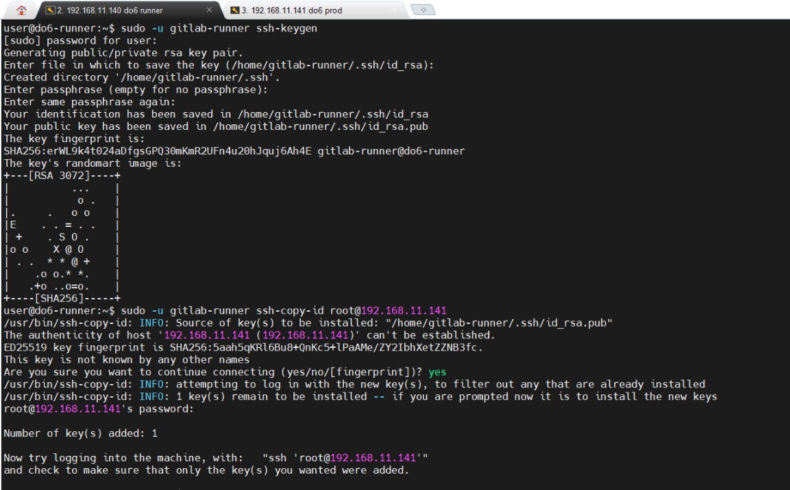\
*Part5. Действительно, в DO2_LinuxNetwork мы что-то подобное делали*

Попробуем просто что-нибудь на прод закинуть:

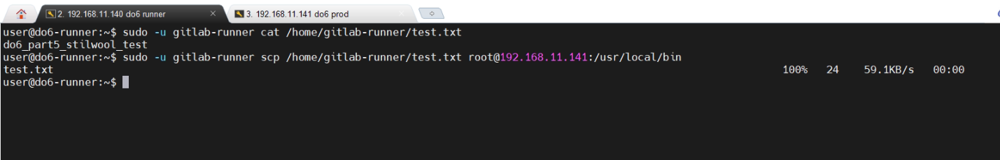\
*Part5. Создали файл, передали файл*

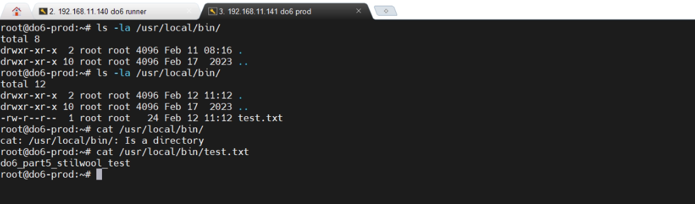\
*Part5. Файла не было, файл есть*

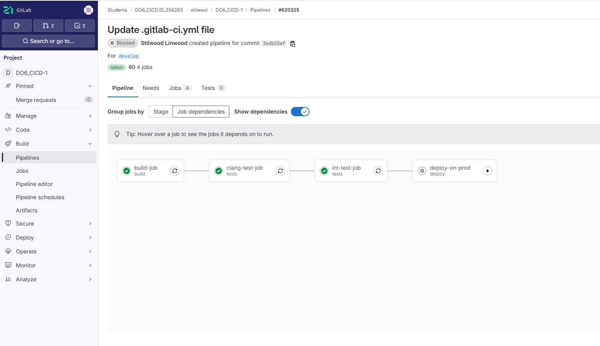\
*Part5. Согласно условию, задача не запускается, пока не жамкнуть на неё самому*

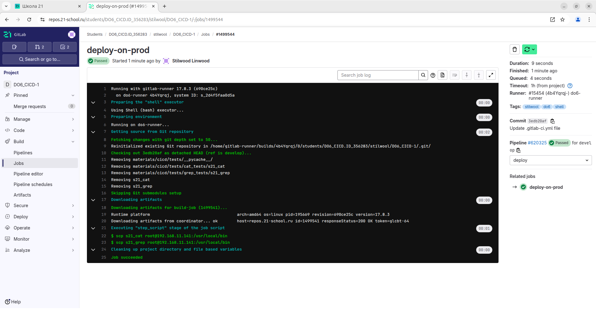\
*Part5. Пишет, что все прошло замечательно*

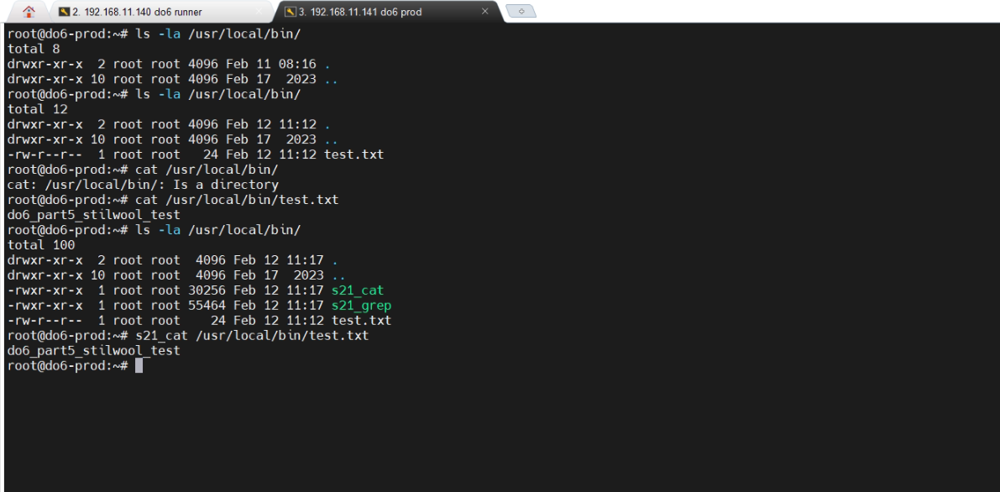\
*Part5. -Мы счастливы, Винсент? -Да, мы счастливы.*

Итоговый пайплайн находится в файле gitlab-ci-opt1.yml

## Способ 2

Теперь о грустном.\
Я не буду говорить о том, что при способе, описанном выше, у безопасника выпадут последние волосы и кончится матерный словарный запас.\
Можно какие-то вещи улучшить, обезопасить. К примеру, использовать раннер и на проде. Или, при прямом пинге от гитлаба до прода сразу на прод и закидывать.\
Но все же, мы должны следить за двумя системами. Не позволять заходить на раннер всем подряд и т.д.

Другим же вариантом является использование докер-раннера.\
Преимущества:
- Нам не надо взаимодейтсвовать с раннером
- Нам все равно, что на раннере есть, чего нет
- Это может быть рандомный раннер, подходящий под теги и доступный на данный момент
- Докер контейнеры удаляются после выполнения задачи

АТЕНСЬЁН!!! Я буду делать максимально проще, без докерфайлов или еще каких-то полезных вещей. Просто как показательный вариант.

## Part 1. Перед сборкой

Сначала, и, в сущности, енто все, что надо сделать с раннером, надо настройить раннер на докер.\
Зададим новую регистрацию, только выберем не shell, а docker.\
Теги используем почти те же: stilwool,do6,runner. Теперь конфиг выглядит так:
```
root@do6-runner:/home/user# cat /etc/gitlab-runner/config.toml
concurrent = 1
check_interval = 0
connection_max_age = "15m0s"
shutdown_timeout = 0

[session_server]
  session_timeout = 1800

[[runners]]
  name = "do6-runner"
  url = "https://repos.21-school.ru"
  id = 15431
  token = "Ez4FLQqcrPM3CT1rFxvo"
  token_obtained_at = 2025-02-07T18:28:36Z
  token_expires_at = 0001-01-01T00:00:00Z
  executor = "docker"
  [runners.custom_build_dir]
  [runners.cache]
    MaxUploadedArchiveSize = 0
    [runners.cache.s3]
    [runners.cache.gcs]
    [runners.cache.azure]
  [runners.docker]
    tls_verify = false
    image = "ubuntu:latest"
    privileged = false
    disable_entrypoint_overwrite = false
    oom_kill_disable = false
    disable_cache = false
    volumes = ["/cache"]
    shm_size = 0
    network_mtu = 0

[[runners]]
  name = "do6-runner"
  url = "https://repos.21-school.ru"
  id = 15454
  token = "4b4Yqrqj-XHYYuwP3m9E"
  token_obtained_at = 2025-02-11T12:33:14Z
  token_expires_at = 0001-01-01T00:00:00Z
  executor = "shell"
  [runners.custom_build_dir]
  [runners.cache]
    MaxUploadedArchiveSize = 0
    [runners.cache.s3]
    [runners.cache.gcs]
    [runners.cache.azure]
```

## Part 2. Сборка

Вот у нас чистая убунта, лишь докер и раннер. Попробуем просто собрать проект, для начала:
```
stages:
  - build

build-job:
  stage: build
  image: gcc:latest
  tags:
    - stilwool
    - do6
    - runner
  script:
    - make -C ./src/cat/
    - make -C ./src/grep/
    - mv src/cat/s21_cat ./
    - mv src/grep/s21_grep ./
  artifacts:
    paths:
      - s21_cat
      - s21_grep
```

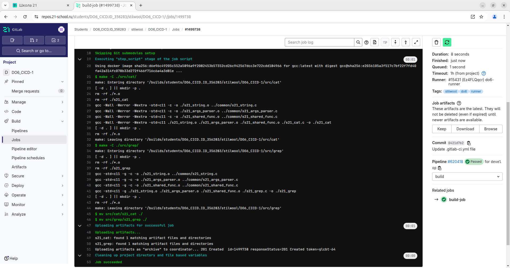\
*Part2. Сработало. И даже артефакты есть*

## Part 3. Тест кодстайла и Part 4. Интеграционные тесты

Тут все просто, выбираем нужные образы, отмечаем, понадобится ли работа с артефактами, при необходимости, устанавливаем программы:
```
clang-test-job:
  stage: tests
  needs:
    - job: build-job
      artifacts: false
  image: gcc:latest
  tags:
    - stilwool
    - do6
    - runner
  script:
    - apt update && apt install clang-format -y
    - cp ./materials/linters/.clang-format ./src/cat/.clang-format
    - cp ./materials/linters/.clang-format ./src/grep/.clang-format
    - cp ./materials/linters/.clang-format ./src/common/.clang-format
    - clang-format -Werror -n ./src/cat/*.c
    - clang-format -Werror -n ./src/grep/*.c
    - clang-format -Werror -n ./src/common/*.c

int-test-job:
  stage: tests
  needs:
    - job: build-job
      artifacts: true
    - job: clang-test-job
      artifacts: false
  image: ubuntu:latest
  tags:
    - stilwool
    - do6
    - runner
  script:
    - apt update && apt install python3 -y && ln -sf python3 /usr/bin/python
    - cp s21_cat materials/cicd/tests/cat_tests/s21_cat
    - cp s21_grep materials/cicd/tests/grep_tests/s21_grep
    - cd materials/cicd/tests/
    - python3 test_cat.py
    - python3 test_grep.py
```

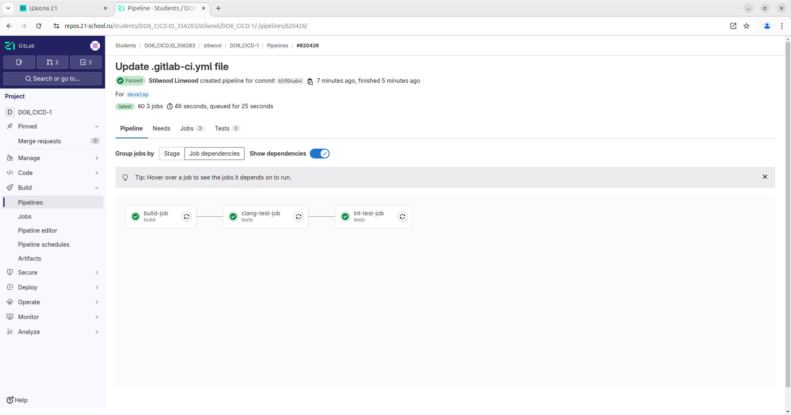\
*Part3-4. Ожидаемо, все прошло хорошо*

## Part 4. Интеграционные тесты

Теперь поговорим за тесты более внимательно.\
Попробуем использовать всё ту же логику, когда каждая строка тест пресета - ключи и аргументы к команде,\
однако, будем использовать какой-нибудь удобный фреймворк. Pytest, к примеру.\
Тогда тестовый скрипт будет примерно такой:
```
import os
import subprocess
import sys
import pytest


def collect_info(my, og, pwd):
    test_presets = "test_presets.txt"
    results = []
    
    os.chdir(pwd)
    if not os.path.isfile(test_presets):
        print("File with arg presets 'test_presets.txt' not found")
        sys.exit(1)
            
    if not os.path.isfile(my):
        print(f"Programm to tests not found")
        sys.exit(1)

    with open(test_presets) as tests:
        
        for test in tests:
            if not test.rstrip():
                print('----')
                continue

            args = test.rstrip().split(' ')
            my_prog_result = subprocess.run([my] + args, capture_output=True).stdout.strip()
            orig_prog_result = subprocess.run([og] + args, capture_output=True).stdout.strip()

            new_line = {'arguments':args, 'input':my_prog_result, 'expected_result':orig_prog_result}
            results.append(new_line)
    os.chdir("..")
    return results

@pytest.mark.parametrize('test_data', collect_info("./s21_cat", "cat", "./cat_tests"))
def test_cat(test_data):
    assert test_data['input'] == test_data['expected_result'], \
    f'Разница при вызове {test_data['arguments']}'

@pytest.mark.parametrize('test_data', collect_info("./s21_grep", "grep", "./grep_tests"))
def test_grep(test_data):
    assert test_data['input'] == test_data['expected_result'], \
    f'Разница при вызове {test_data['arguments']}'
```

Создаем массив выводов комманд, а потом в тест-кейсах сравниваем.\
А задача в пайплайне будет такой:
```
int-test-job:
  stage: tests
  needs:
    - job: build-job
      artifacts: true
    - job: clang-test-job
      artifacts: false
  image: ubuntu:latest
  tags:
    - stilwool
    - do6
    - runner
  script:
    - apt update && apt install python3 -y && ln -sf python3 /usr/bin/python && apt install python3-pytest -y
    - cp s21_cat materials/cicd/tests/cat_tests/s21_cat
    - cp s21_grep materials/cicd/tests/grep_tests/s21_grep
    - cd materials/cicd/tests/
    - pytest test_pytest.py --junitxml=report.xml -v
  artifacts:
    when: always
    paths:
      - materials/cicd/tests/report.xml
    reports:
      junit: materials/cicd/tests/report.xml
    expire_in: 1 day
```

Ну и к вопросу, зачем нам фреймворк для тестов, который умеет выводить xml репорты в формате junit:

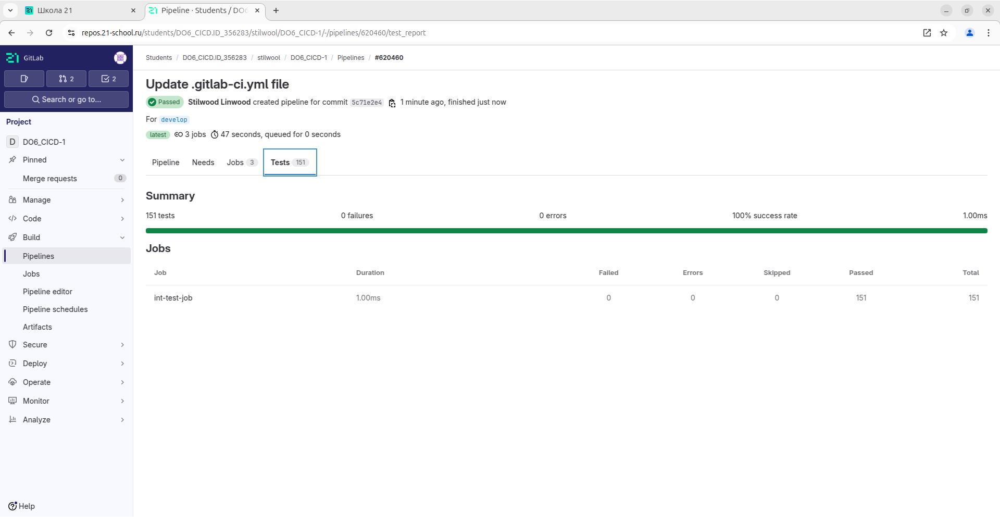\
*Part4. Наглядность, картинка раз*

\
*Part4. Наглядность, картинка два*

А мы же помним, что кат у нас поломанный. Добавляем стрелу ему в пятку и вот что видим:

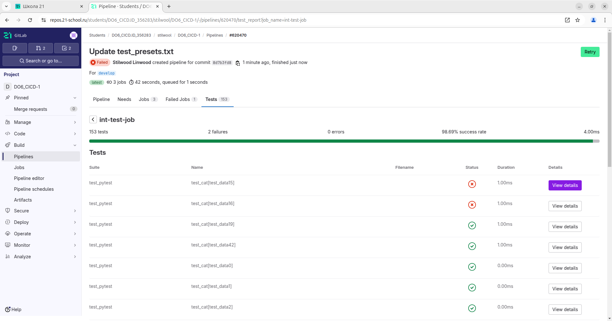\
*Part4. FAILED SUCCESSFULLY*

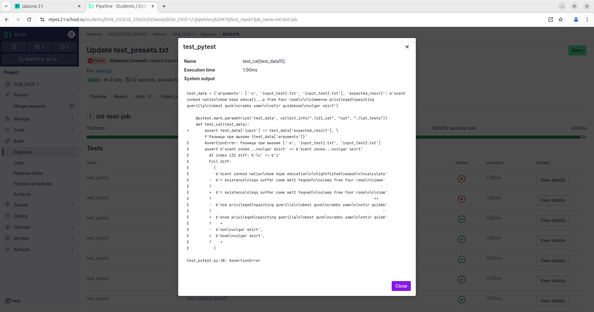\
*Part4. Можно и больше деталей почитать*

И кстати, вы еще не забыли, что мы начали второй способ с преимуществ докер-раннера?\
Вот вам наглядно выполнение пайплайна:

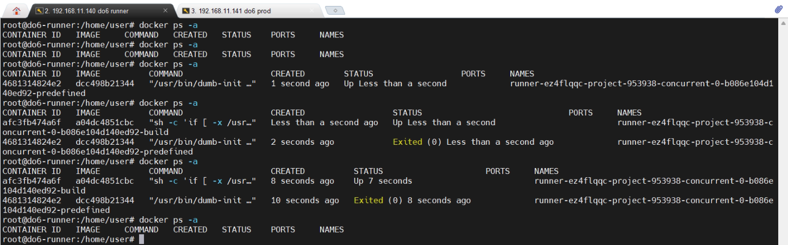\
*Part4. То ничего нет, то ничего есть, то снова нет*

## Part 5. Этап деплоя

Для деплоя тоже будем использовать контейнер.\
Да, идея не самая лучшая, ибо на проде скопится куча ssh ключей, но даже так лучше, чем вручную настраивать раннер и прод:
```
deploy-on-prod:
  stage: deploy
  when: manual
  image: ubuntu:latest
  allow_failure: false
  needs:
    - job: build-job
      artifacts: true
    - job: clang-test-job
      artifacts: false
    - job: int-test-job
      artifacts: false
  tags:
    - stilwool
    - do6
    - runner
  script:
    - apt update && apt upgrade -y && apt install openssh-client -y && apt install sshpass
    - ssh-keygen -t rsa -b 2048 -q -N "" -f ~/.ssh/id_rsa
    - sshpass -p $PROD_PASSWORD ssh-copy-id -f -o StrictHostKeyChecking=no root@192.168.11.141
    - scp s21_cat root@192.168.11.141:/usr/local/bin
    - scp s21_grep root@192.168.11.141:/usr/local/bin
```

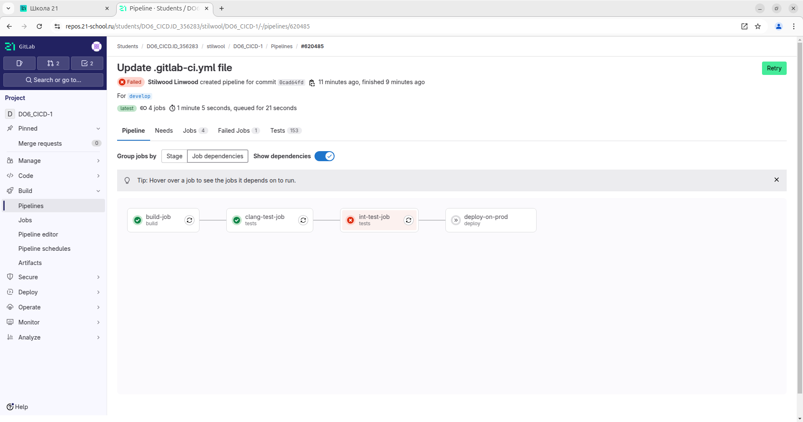\
*Part5. А, ну да. Мы же себе колено прострелили*

Причем, как вы видите, мы используем переменные.\
Да, в данном задании у нас нету правов на определение переменных, но мы можем енто делать при старте пайплайна:

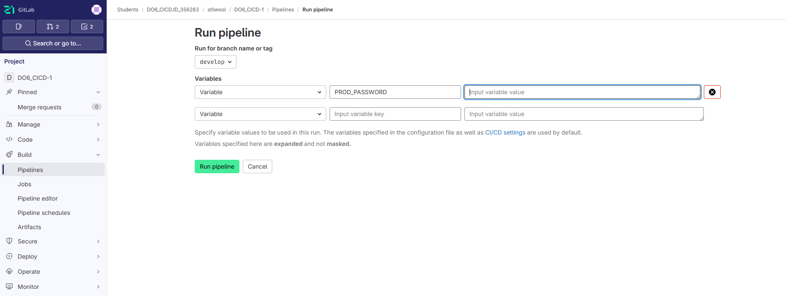\
*Part5. Используйте переменные*

Ну и успешный пайплайн:

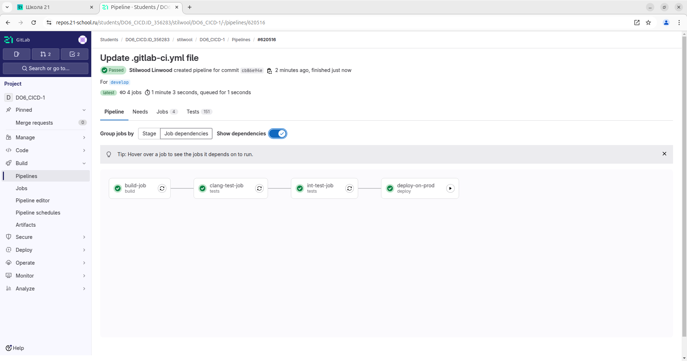\
*Part5. Всё зелененькое*

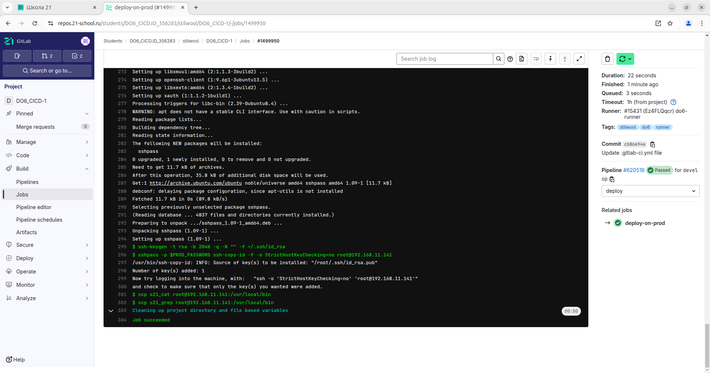\
*Part5. И секурненько... относительно*

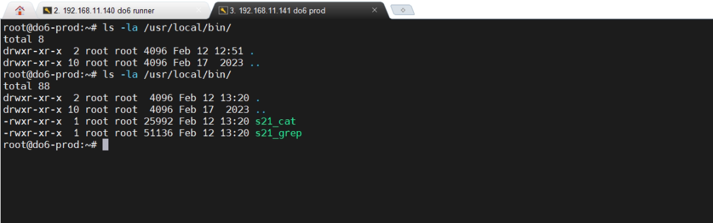\
*Part5. Все там, где и должно быть и без bash скриптов*

## Часть после 5й, но до 6й

Весь получившийся пайплайн я сохранил в файл gitlab-ci-opt2.yml\
Можно заметить, что он длинный, неудобочитаемый и т.д.\
Программистов заставляют декомпозировать, тот файл тестов для PyTest тоже бы порезать, но ентим пусть займутся тестеры.\
А мы декомпозируем немного наш пайплайн. Совсем чуть-чуть. Вынесем за скобки скрипты.

Создадим в materials/cicd папку ymls.\
В ней будут следующие файлы:
- build-scripts.yml
- tests-scripts.yml
- deploy-scripts.yml

В build-scripts.yml пропишем следующее:
```
.script:build-script:
  script:
    - make -C ./src/cat/
    - make -C ./src/grep/
    - mv src/cat/s21_cat ./
    - mv src/grep/s21_grep ./
```

В tests-scripts.yml пропишем:
```
.script:clang-tests-script:
  script:
    - apt update && apt install clang-format -y
    - cp ./materials/linters/.clang-format ./src/cat/.clang-format
    - cp ./materials/linters/.clang-format ./src/grep/.clang-format
    - cp ./materials/linters/.clang-format ./src/common/.clang-format
    - clang-format -Werror -n ./src/cat/*.c
    - clang-format -Werror -n ./src/grep/*.c
    - clang-format -Werror -n ./src/common/*.c

.script:int-tests-script:
  script:
    - apt update && apt install python3 -y && ln -sf python3 /usr/bin/python && apt install python3-pytest -y
    - cp s21_cat materials/cicd/tests/cat_tests/s21_cat
    - cp s21_grep materials/cicd/tests/grep_tests/s21_grep
    - cd materials/cicd/tests/
    - pytest test_pytest.py --junitxml=report.xml -v
```

В deploy-scripts.yml пропишем:
```
.script:deploy-script:
  script:
    - apt update && apt upgrade -y && apt install openssh-client -y && apt install sshpass
    - ssh-keygen -t rsa -b 2048 -q -N "" -f ~/.ssh/id_rsa
    - sshpass -p $PROD_PASSWORD ssh-copy-id -f -o StrictHostKeyChecking=no root@192.168.11.141
    - scp s21_cat root@192.168.11.141:/usr/local/bin
    - scp s21_grep root@192.168.11.141:/usr/local/bin
```

А сам .gitlab-ci.yml будет следующим:
```
include:
    - local: '/materials/cicd/ymls/build-scripts.yml'
    - local: '/materials/cicd/ymls/tests-scripts.yml'
    - local: '/materials/cicd/ymls/deploy-scripts.yml'

default:
  tags:
    - stilwool
    - do6
    - runner

stages:
  - build
  - tests
  - deploy

build-job:
  stage: build
  image: gcc:latest
  extends:
    - .script:build-script
  artifacts:
    paths:
      - s21_cat
      - s21_grep

clang-test-job:
  stage: tests
  needs:
    - job: build-job
      artifacts: false
  image: gcc:latest
  extends:
    - .script:clang-tests-script

int-test-job:
  stage: tests
  needs:
    - job: build-job
      artifacts: true
    - job: clang-test-job
      artifacts: false
  image: ubuntu:latest
  extends:
    - .script:int-tests-script
  artifacts:
    when: always
    paths:
      - materials/cicd/tests/report.xml
    reports:
      junit: materials/cicd/tests/report.xml
    expire_in: 1 day

deploy-on-prod:
  stage: deploy
  when: manual
  image: ubuntu:latest
  allow_failure: false
  needs:
    - job: build-job
      artifacts: true
    - job: clang-test-job
      artifacts: false
    - job: int-test-job
      artifacts: false
  extends:
    - .script:deploy-script
```

Далеко не идеал, но для начала сойдет. Вынести за скобки можно в сущности все, даже сами задачи. Будут собираться в зависимости от переменных.\
Ентим я лишь хочу показать, что нам в руки попал крайне мощный инструмент, с помощью которого можно положить любой прод.

## Part 6. Дополнительно. Уведомления

== Задание ==\
Настрой уведомления об успешном/неуспешном выполнении пайплайна через бота с именем «[твой nickname] DO6 CI/CD» в Telegram.\
Текст уведомления должен содержать информацию об успешности прохождения как этапа CI, так и этапа CD.\
В остальном текст уведомления может быть произвольным.

Уууф... Путь до сюда был долгий и сухой. Но вот мы тут.

Основываться мы будем на ентой статье:\
https://blog.rvalitov.ru/development/git/dobavit-uvedomleniya-v-telegram-gitlab-ci/

Сам бот будет прикручен через yml файл. Закинем его к остальным и назовем telegram-messages.yml\
Выглядеть скрипт для него будет так:
```
.script:telegram-message:
  - 'curl -s -d "chat_id="$CHAT_ID"&disable_web_page_preview=1&text=$SENT_MESSAGE" https://api.telegram.org/bot$BOT_TOCKEN/sendMessage'

.script:afterscript-build:
  after_script:
    - >
        if [ $CI_JOB_STATUS == 'success' ]; then
          SENT_MESSAGE="Build-job is finished succesfully"
        else
          SENT_MESSAGE="Build-job is failed"
        fi
    - !reference [.script:telegram-message]

.script:afterscript-clang:
  after_script:
    - >
        if [ $CI_JOB_STATUS == 'success' ]; then
          SENT_MESSAGE="Clang test is finished succesfully"
        else
          SENT_MESSAGE="Clang test is failed"
        fi
    - !reference [.script:telegram-message]

.script:afterscript-int-test:
  after_script:
    - >
        if [ $CI_JOB_STATUS == 'success' ]; then
          SENT_MESSAGE="Integration test is finished succesfully. Please start deploy procedury manually"
        else
          SENT_MESSAGE="Integration test is failed"
        fi
    - !reference [.script:telegram-message]

.script:afterscript-deploy:
  after_script:
    - >
        if [ $CI_JOB_STATUS == 'success' ]; then
          SENT_MESSAGE="Congratulations, we have a new version of program."
        else
          SENT_MESSAGE="Deploy is succesfully failed"
        fi
    - !reference [.script:telegram-message]
```

А окончательно (в смысле, что допиливать енто задание дальше я уже не хочу) основной файл пайлайна выглядеть так:
```
include:
    - local: '/materials/cicd/ymls/build-scripts.yml'
    - local: '/materials/cicd/ymls/tests-scripts.yml'
    - local: '/materials/cicd/ymls/deploy-scripts.yml'
    - local: '/materials/cicd/ymls/telegram-messages.yml'

default:
  tags:
    - stilwool
    - do6
    - runner

variables:
  SENT_MESSAGE: ""

stages:
  - build
  - tests
  - deploy

build-job:
  stage: build
  image: gcc:latest
  extends:
    - .script:build-script
    - .script:afterscript-build
  artifacts:
    paths:
      - s21_cat
      - s21_grep


clang-test-job:
  stage: tests
  needs:
    - job: build-job
      artifacts: false
  image: gcc:latest
  extends:
    - .script:clang-tests-script
    - .script:afterscript-clang

int-test-job:
  stage: tests
  needs:
    - job: build-job
      artifacts: true
    - job: clang-test-job
      artifacts: false
  image: ubuntu:latest
  extends:
    - .script:int-tests-script
    - .script:afterscript-int-test
  artifacts:
    when: always
    paths:
      - materials/cicd/tests/report.xml
    reports:
      junit: materials/cicd/tests/report.xml
    expire_in: 1 day


deploy-on-prod:
  stage: deploy
  when: manual
  image: ubuntu:latest
  allow_failure: false
  needs:
    - job: build-job
      artifacts: true
    - job: clang-test-job
      artifacts: false
    - job: int-test-job
      artifacts: false
  extends:
    - .script:deploy-script
    - .script:afterscript-deploy
```

Окно деплоя с телегой выглядит так:

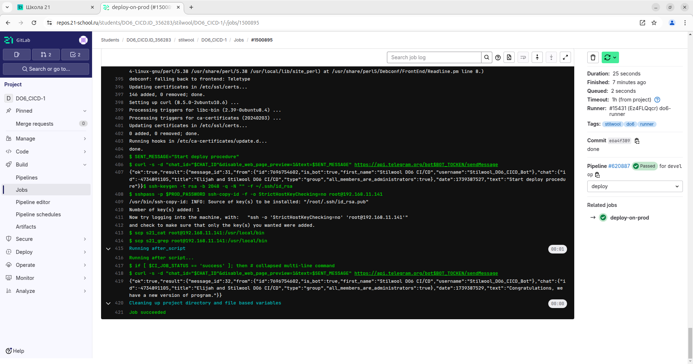\
*Part6. Можно увидеть, как отправляются сообщения*

А в чате бот оповестил так:

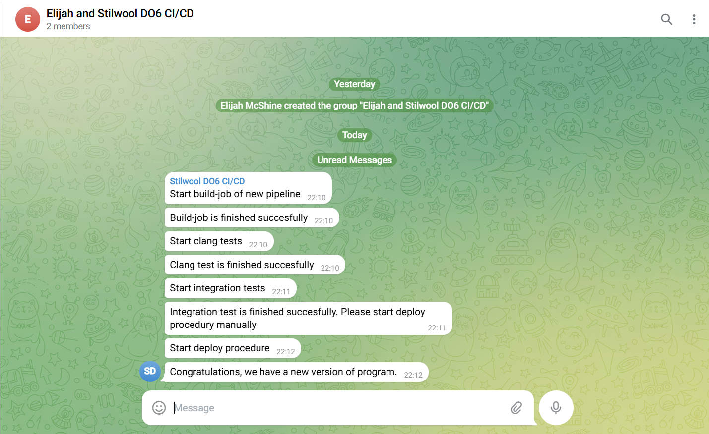\
*Part6. И без капчи понятно, кто пишет*